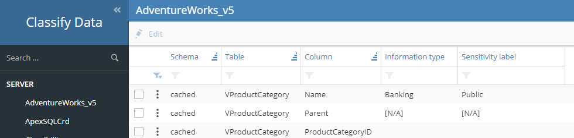
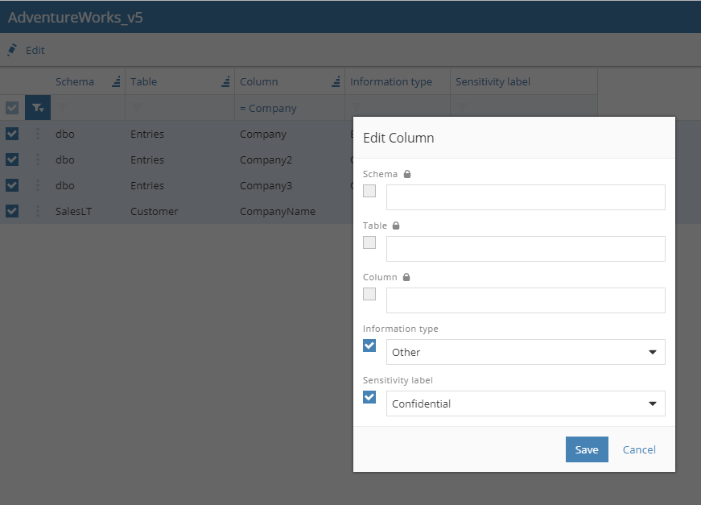

# classify-data
Helper application to use bulk operations on SQL Server's classify data.

## Running the application from source

The application requires Windows and the .NET 10 SDK. Run it with `dotnet run --project ClassifyData.App` (or start ClassifyData.App from Visual Studio). The connection string is in ClassifyData/appsettings.json (it points to server . aka local using integrated security) and can also be changed from the Configuration screen in the app.

In the menu it should show a list of all available databases (if not you might need to check the connection string):

Selecting a database on the left will show all columns on the right, you can open a single row or select multiple to set the information type + sensitivity label in bulk.

You can filter by schema/table/column by clicking right below the column header and either choosing the correct values or by using a partial match.
